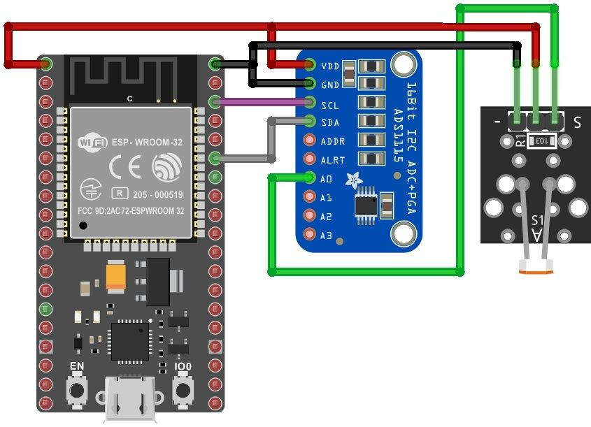
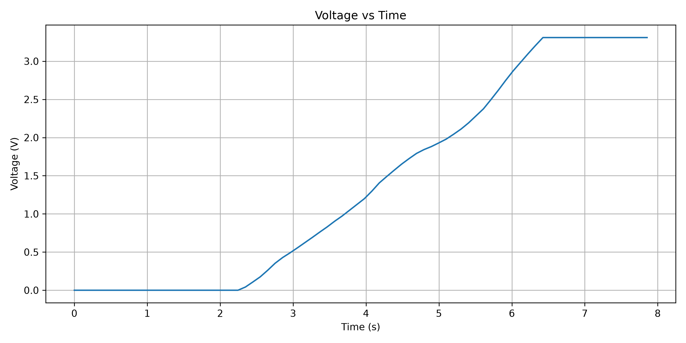

# Лабораторная работа №4
## Сбор аналогового сигнала с помощью ESP32 и ADS1115

### 1. Цель работы

Научиться собирать аналоговый сигнал с помощью ESP32 и модуля ADS1115 и узнать как меняется напряжение при повороте потенциометра.

### 2. Оборудование

Для работы использовались:

- ESP32 — микроконтроллер
- ADS1115 — модуль для измерения напряжения
- Потенциометр B10K — переменный резистор
- Макетная плата
- Соединительные провода

### 3. Схема подключения

| ESP32 | ADS1115 |
|---|---|
| 3V3 | VDD |
| GND | GND |
| GPIO21 | SDA |
| GPIO22 | SCL |

Подключение потенциометра:

- Левая ножка - к 3.3V.
- Правая ножка - к GND.
- Средняя ножка - к A0 ADS1115.

### 4. Ход работы

1. Подключить ESP32 к компьютеру.
2. Соединить ESP32, ADS1115 и потенциометр.
3. Написать программу для ESP32, которая считывает напряжение.
4. Поворачивать ручку потенциометра и наблюдать за изменением напряжения.
5. Построить график изменения напряжения со временем.

### 5. Результаты работы

Во время эксперимента были получены следующие результаты:

| Показатель | Значение |
|---|---:|
| Минимальное напряжение | 0.000 В |
| Максимальное напряжение | 3.310 В |

График изменения напряжения:

